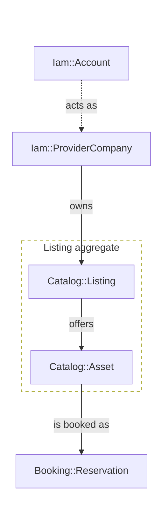

# mermaid-diagram

Red Cab docs use `@docusaurus/theme-mermaid`. A diagram is a fenced block with the info string `mermaid`, inside a page under `docs/`.

Load `write-plain-english` first for the label text and the sentence above the diagram.

## When a diagram earns its place

- A diagram shows a branch, a state change, or a relationship between records.
- A single path of steps with no branch is a numbered list.

| Type | Use |
| --- | --- |
| `flowchart TD` | Domain context, request pipelines, user journeys |
| `sequenceDiagram` | The order of calls between actors |
| `stateDiagram-v2` | The states of a record, such as a booking or a payment |
| `erDiagram` | Relations between tables, for a lead-in to the DBML file |

- Put one sentence above the diagram that says what it shows.
- Write "This diagram is illustrative." when the diagram is not a rule.
- A diagram never overrides a domain decision entry or the DBML file.

## Colour categories

Every coloured node belongs to one of five categories. A `class` line names the category.

| Category | Class name | Use |
| --- | --- | --- |
| Subject, the main topic of the page | `subject` | The record or flow the page is about |
| Host, the domain of the page | `host` | Related models in the same domain, such as `Catalog::` on a Catalog page |
| External | `external` | Other domains, actors, outside services |
| OK | `ok` | A step or a result that works |
| Problem | `problem` | A step or a result that fails, leaks or is missing |

The diagram names the category and writes no colour value:

```mermaid
class LST subject
class AST,SCH host
class ACC,PAY external
```

The colours live in one file, `src/css/mermaid-categories.css`, with one set for each colour mode.
- Docusaurus loads the file through `customCss` in `docusaurus.config.js`.
- The VS Code Markdown preview loads it through `markdown.styles` in `.vscode/settings.json`.
- GitHub does not load the file, so GitHub shows every node in the theme colour.
- To change a colour, change the CSS file, never a diagram.
- The categories work on the nodes of a flowchart and on the states of a `stateDiagram-v2`.

### Every colour must read in light and dark mode

| Part of the diagram | Who sets its colour | Rule |
| --- | --- | --- |
| A node of a category | `src/css/mermaid-categories.css` | Write `class <node> subject`, `host`, `external`, `ok` or `problem`, and no colour value |
| Any other node | The Mermaid theme in `docusaurus.config.js` | Set no colour |
| Lines, line labels, subgraph borders and subgraph titles | The Mermaid theme | Set no colour |
| One line that must stand out | The diagram, with `linkStyle` | Use `#e5484d`, which has at least 3:1 contrast on both pages |
| A `box` or a `rect` in a sequence diagram | The diagram | Use a see-through colour such as `rgba(255, 166, 77, 0.15)` |
| The `init` directive | The page's mode | Set no `theme`, and no colour in `themeVariables` |

A `classDef` or a `style` line may still set shape properties that carry no colour.
- `style agg fill:none,stroke-dasharray:5 5` draws a dashed border in the theme colour.
- `style ext_row fill:none,stroke:none` hides a layout subgraph.

```
%% Wrong: a colour value in the diagram
classDef subject fill:#ff9,stroke:#333,color:#333
class LST subject
%% Right: the diagram names the category, and the CSS file colours it
class LST subject
```

Run the colour check before you commit a diagram. It must print 0.

```bash
python3 .claude/skills/mermaid-diagram/scripts/check_mermaid_colours.py <file or folder>
```

- It checks colours only, so also look at the page in both modes, see "MDX and render checks".

## Layout

The diagram must grow down, never wide. Docusaurus scales a diagram to the page width, so a wide diagram shrinks until its labels cannot be read.

- Use `flowchart TD` for domain context diagrams.
- Add this directive at the top of a diagram with 8 or more nodes:

```
%%{init: {'flowchart': {'defaultRenderer': 'elk'}}}%%
```

- Group source nodes in an invisible subgraph so they sit in one row.
  - The label must be `" "` (one space), not empty.
  - The inner `direction` is the opposite of the outer one: `direction LR` inside a `flowchart TD`.

```mermaid
subgraph sources[" "]
    direction LR
    ACC["Iam::Account"]
    PAY["Payments::Charge"]
end
style sources fill:none,stroke:none
```

- Use `flowchart LR` only when 5 or more satellites sit on one side of a hub.
  - Rank position follows the edge direction, so count the nodes pointing in and the nodes pointing out separately.
  - Put that group in an invisible subgraph with `direction TB`, so it forms a column.
  - A hub with satellites on both sides stays `TD`.
- Keep an aggregate boundary as a visible dashed subgraph, with a real label and no stroke colour.
- Do not wrap the whole host domain in a subgraph. The `host` colour already says it.
- Split a diagram above about 12 nodes. One diagram shows one concern.

## Labels and edges

- A node ID is `camelCase` or `snake_case`, and the human text goes in brackets.
- A node that is a record uses its full model name: `Booking::Reservation`, never "the booking".
- A solid arrow (`-->`) is a structural dependency that is always on.
- A dotted arrow (`-.->`) is a relationship that is optional or cross-cutting.
- An edge label is a short phrase. "copies price into" is better than "copies".
- The viewBox does not reserve room for edge labels, so a long label is cut off.
  - In a flowchart, wrap with `<br/>` and keep each line to about 3 words.
  - In a `stateDiagram-v2`, keep a transition label to 4 words or fewer, and put the full sentence in a table below the diagram.
  - `\n` never works in a label.
- Declare edges in the order their sources appear in their row, so the labels do not scramble.
- In a sequence diagram, use one column for each actor. Name the actor by its role: tourist, provider, API, web.
- In a state diagram, states are nouns and edges are verbs.
- Put a one-line legend directly below the diagram when colour or shape carries meaning.

## MDX and render checks

- A bare `<=` or `>=` in prose outside a code block breaks the MDX build, so wrap it in backticks.
- Put `{` and `}` in prose inside backticks, because MDX reads them as JSX.
- In a `stateDiagram-v2`, a second colon in a label breaks the parser. Remove the prefix and put it in the table below.
- Run `npm run build` to catch parse errors.
- Open the rendered page in light mode and in dark mode.
  - Add `?docusaurus-theme=dark` to the page URL for dark mode.
  - Add `?docusaurus-theme=light` to return.
- Do not rely on colour alone. The edge label or the legend must carry the meaning too.

## Canonical template: domain context diagram

The names are illustrative. Adapt them to the page.

````markdown
## Model context

This diagram is illustrative. It shows the records around `Catalog::Listing`.



> **Legend:** The orange node is the subject of this page. Lavender nodes belong to the Catalog domain. Grey nodes belong to other domains. The dashed box is the aggregate boundary.
````

## Troubleshooting

| Symptom | Likely cause | Fix |
| --- | --- | --- |
| Diagram too wide, text too small | A wide layout scaled to the page width | Use `flowchart TD`, and group each rank in an invisible subgraph |
| Edge labels overlap | Many edges converge on one node | Shorten the labels, and reorder the edges to match the source order |
| Edge label cut off | The viewBox does not reserve room for it | Wrap with `<br/>` in a flowchart, or shorten it in a state diagram |
| A node keeps a light colour in dark mode | The diagram sets a colour with `classDef` or `style` | Remove the colour, and write a `class` line |
| A dashed border or a line disappears in dark mode | It sets a dark colour such as `stroke:#333` | Remove the colour, so the theme picks one |
| The VS Code preview shows no category colours | VS Code has not loaded the CSS file | Open the docs repo as the VS Code folder, and open the preview again |
| Text on a sequence `box` is pale in dark mode | The `box` colour is solid | Use a see-through colour such as `rgba(255, 166, 77, 0.15)` |

## Checklist before you commit

- [ ] One sentence above the diagram, and a legend below it when colour carries meaning
- [ ] `flowchart TD`, with the ELK directive when there are 8 or more nodes
- [ ] Coloured nodes use `class` lines with the five categories, and the subject node has `class <node> subject`
- [ ] No colour value in a `classDef`, a `style` line or the `init` directive
- [ ] `check_mermaid_colours.py` prints 0
- [ ] Source nodes in invisible subgraphs when there are 3 or more
- [ ] Edges declared in source order
- [ ] No bare `<=` or `>=` in prose
- [ ] `npm run build` passes, and the page was viewed in light and dark mode
