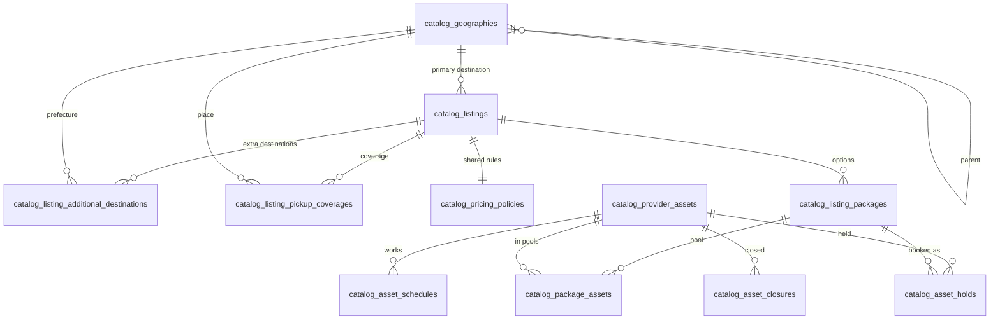

## TL;DR \{#catalog-overview\}

- Catalog owns listings, packages, geography, pickup coverage, asset availability and tourist discovery.
- A tourist browses by region first, and only discoverable listings appear in results.
- A package is what a tourist buys: vehicle, passenger limit, duration, start window and price.
- Every booking holds one asset for one time range, and one database rule stops overlap.
- The global [Invariants](/docs/70-79-business/business-rules/invariants) rank above every page of this domain.

## About this document

This page is the front door of the Catalog domain, so read it before any Catalog code, spec or review.

| Topic | Document |
| --- | --- |
| Precedence of documents | [Documentation system](/docs/00-09-meta/conventions/documentation-system#precedence) |
| Global rules | [Invariants](/docs/70-79-business/business-rules/invariants) and [Glossary](/docs/70-79-business/business-rules/glossary) |
| Pricing authority | [ADR-005: Single pricing authority](/docs/30-49-domains/architecture-decisions/adr-005-single-pricing-authority) |
| Bounded context summary | [Catalog and Inventory context](/docs/30-49-domains/bounded-contexts/catalog) |
| Column truth | [catalog.dbml](https://github.com/markmamba/red-cab-api/blob/main/docs/db/catalog.dbml) |
| Shipping specs | [Implementation specs](/docs/60-69-initiatives/61-2026/implementation-specs/) |
| Program plan, not a rule source | [Catalog revamp 2026](/docs/60-69-initiatives/61-2026/catalog-revamp-2026/) |

Status: current, approved by the principal developer on 2026-10-18 and 2026-10-23.

---

## Words used in this doc \{#words\}

| Word | Meaning |
| --- | --- |
| region | The top level of the geography tree, for example Kanto. |
| prefecture | A node with `level: "subdivision"`, for example Tokyo. A listing destination is always a prefecture. |
| destination | A prefecture where a service runs. A listing has one primary destination and may have extra ones. |
| pickup coverage | The places where the provider picks up tourists. It is separate from destinations. |
| listing | One bookable service of one provider, a row in `catalog_listings`. |
| package | One sellable option of a listing, a row in `catalog_listing_packages`. It is not a Multi-Day Package (`E-04`). |
| asset | A vehicle or a guide of one provider, a row in `catalog_provider_assets`. |
| asset hold | One row in `catalog_asset_holds`. It holds one asset for one time range for one booking attempt. |
| starting price | The lowest price among the available packages of a listing, shown as "From ¥X". |
| discoverable | A listing that may appear in browse and search. |

## The model on one page \{#model\}

This diagram is illustrative, and the DBML file gives the columns.

| Table | Holds | Model page |
| --- | --- | --- |
| `catalog_geographies` | The tree: region, prefecture, municipality, ward | [Geography](/docs/30-49-domains/catalog/models/geography) |
| `catalog_listings` | The listing and its primary destination | [Listings and packages](/docs/30-49-domains/catalog/models/listings-and-packages) |
| `catalog_listing_additional_destinations` | Extra destinations | [Listings and packages](/docs/30-49-domains/catalog/models/listings-and-packages) |
| `catalog_listing_pickup_coverages` | Pickup coverage | [Listings and packages](/docs/30-49-domains/catalog/models/listings-and-packages) |
| `catalog_listing_packages` | The sellable options | [Listings and packages](/docs/30-49-domains/catalog/models/listings-and-packages) |
| `catalog_pricing_policies` | Pricing mode and cancellation for the listing | [Listings and packages](/docs/30-49-domains/catalog/models/listings-and-packages) |
| `catalog_provider_assets` | Vehicles and guides | [Asset availability](/docs/30-49-domains/catalog/models/asset-availability) |
| `catalog_package_assets` | The asset pool of a package | [Asset availability](/docs/30-49-domains/catalog/models/asset-availability) |
| `catalog_asset_schedules`, `catalog_asset_closures` | Working days of an asset | [Asset availability](/docs/30-49-domains/catalog/models/asset-availability) |
| `catalog_asset_holds` | One hold for each booking attempt | [Asset availability](/docs/30-49-domains/catalog/models/asset-availability) |

## Reading order \{#reading-order\}

| Question | Open this page |
| --- | --- |
| What did we decide, and why? | [Catalog decisions](/docs/30-49-domains/catalog/catalog-decisions/#catalog-decisions-tldr) |
| What does a tourist see when they browse or search? | [Tourist browse and search](/docs/30-49-domains/catalog/requirements/tourist-browse-and-search) |
| What happens at booking? | [Tourist booking](/docs/30-49-domains/catalog/requirements/tourist-booking) |
| What does a provider do? | [Provider listings](/docs/30-49-domains/catalog/requirements/provider-listings) |
| How is the geography tree built? | [Geography model](/docs/30-49-domains/catalog/models/geography) |
| How do listings, packages and prices fit together? | [Listings and packages model](/docs/30-49-domains/catalog/models/listings-and-packages) |
| What blocks a vehicle? | [Asset availability model](/docs/30-49-domains/catalog/models/asset-availability) |
| Why this design, and what else did we weigh? | [Architecture decisions](/docs/30-49-domains/catalog/architecture-decisions/region-level) |
| What was this called before? | [Naming and legacy aliases](/docs/30-49-domains/catalog/naming-and-legacy-aliases/#naming-tldr) |

## Rule index \{#rule-index\}

Each rule has one section in [Catalog decisions](/docs/30-49-domains/catalog/catalog-decisions/#catalog-decisions-tldr).

| Rule | Link |
| --- | --- |
| Tourist discovery information architecture | [tourist-discovery-ia](/docs/30-49-domains/catalog/catalog-decisions/#tourist-discovery-ia) |
| Region level | [region-level](/docs/30-49-domains/catalog/catalog-decisions/#region-level) |
| Keyword search scope | [keyword-search-scope](/docs/30-49-domains/catalog/catalog-decisions/#keyword-search-scope) |
| Marketplace filter combination | [marketplace-filter-combination](/docs/30-49-domains/catalog/catalog-decisions/#marketplace-filter-combination) |
| Starting price and price filter | [starting-price-and-price-filter](/docs/30-49-domains/catalog/catalog-decisions/#starting-price-and-price-filter) |
| Marketplace sort options | [marketplace-sort-options](/docs/30-49-domains/catalog/catalog-decisions/#marketplace-sort-options) |
| Most booked sort | [most-booked-sort](/docs/30-49-domains/catalog/catalog-decisions/#most-booked-sort) |
| Top rated sort | [top-rated-sort](/docs/30-49-domains/catalog/catalog-decisions/#top-rated-sort) |
| Destination structure | [destination-structure](/docs/30-49-domains/catalog/catalog-decisions/#destination-structure) |
| Pickup coverage registration | [pickup-coverage-registration](/docs/30-49-domains/catalog/catalog-decisions/#pickup-coverage-registration) |
| Pickup coverage validation timing | [pickup-coverage-validation-timing](/docs/30-49-domains/catalog/catalog-decisions/#pickup-coverage-validation-timing) |
| Listing publication | [listing-publication](/docs/30-49-domains/catalog/catalog-decisions/#listing-publication) |
| Discoverability completeness | [discoverability-completeness](/docs/30-49-domains/catalog/catalog-decisions/#discoverability-completeness) |
| Booking confirmation | [booking-confirmation](/docs/30-49-domains/catalog/catalog-decisions/#booking-confirmation) |
| Packages and pricing policy | [packages-and-pricing-policy](/docs/30-49-domains/catalog/catalog-decisions/#packages-and-pricing-policy) |
| Asset holds | [asset-holds](/docs/30-49-domains/catalog/catalog-decisions/#asset-holds) |
| Listing slug | [listing-slug](/docs/30-49-domains/catalog/catalog-decisions/#listing-slug) |
| Popular destinations and images | [popular-destinations-and-images](/docs/30-49-domains/catalog/catalog-decisions/#popular-destinations-and-images) |
| Legacy geography roles | [legacy-geography-roles](/docs/30-49-domains/catalog/catalog-decisions/#legacy-geography-roles) |
| Schema ground rules | [schema-ground-rules](/docs/30-49-domains/catalog/catalog-decisions/#schema-ground-rules) |
| Release order | [release-order](/docs/30-49-domains/catalog/catalog-decisions/#release-order) |

## Do not do \{#do-not-do\}

- Do not use the availability slot, the seat counter or the slot overlap rule in new code.
- Do not read `is_discovery_root`, `discovery_root_id`, District or Area in new code.
- Do not accept a price from the client, because pricing authority is singular (`PRC-1`).
- Do not read the display price columns at checkout, because checkout always quotes again.
- Do not treat a destination as pickup coverage.
- Do not add a column that no slice reads, or a derived column with two writers.
- Do not change a confirmed booking when catalog data changes (`INV-1`).
- Do not cite the scratchpad or `80-89-legacy` pages as rules.

## Delivery releases and slices \{#delivery-slices\}

Catalog ships in five releases, and each slice has one approved implementation spec.

| Release | Slices | Tourists get |
| --- | --- | --- |
| 1. Browse | S1, S2, S3, S7 and keyword search | Region cards, region and prefecture pages, keyword search, and Recently added and Top rated sort. The card keeps today's single price. |
| 2. Holds | S5 | No visible change. Slots become asset holds, and each listing has one default full-day package. |
| 3. Packages | S4 | Many packages, timed packages, the price, vehicle and group size filters, and Price: low to high sort. |
| 4. Coverage and booking | S6 | Pickup coverage, one booking location and the coverage check. |
| 5. Cleanup | S8 and S9 | Most booked sort. Legacy roles and slot code are removed. |

The ruling is [Release order](/docs/30-49-domains/catalog/catalog-decisions/#release-order).

| Slice | Content | Release |
| --- | --- | --- |
| S1 | Region tree and seed | 1 |
| S2 | Primary destination | 1 |
| S3 | Additional destinations | 1 |
| S4 | Many packages, timed packages, display prices and filters | 3 |
| S5 | Asset holds, schedules, closures, the package table with its asset pool, and one default package for each listing | 2 |
| S6 | Pickup coverage | 4 |
| S7 | Listing slug | 1 |
| S8 | Sort extras: Top rated index in release 1, Most booked count in release 5 | 1 and 5 |
| S9 | Cleanup: legacy geography roles and slot code | 5 |

## Open questions \{#open-questions\}

Open items live only in [Open questions](/docs/30-49-domains/catalog/catalog-decisions/#open-forks).

- They are proposed, not agreed, and no page may treat them as rules.
- Product Owner sign-off on these rulings is not recorded.
