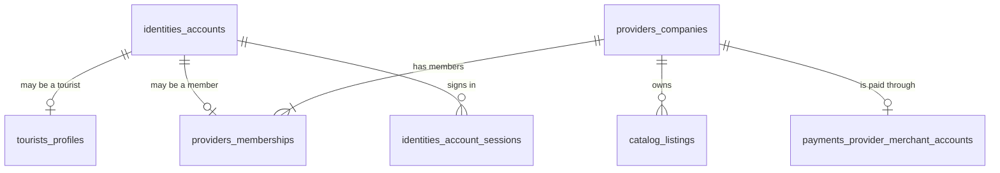

## TL;DR \{#iam-overview\}

- IAM owns the person account, the sign-in, the session and the active portal.
- One account is one person, and an account has no role.
- A person may have a tourist profile and one membership in one provider company.
- A provider company owns the business, and its members are Owner or Staff.
- A person switches between the tourist portal and the provider portal without a new sign-in.
- Each sign-in is one database record, and nothing refreshes.
- The URL decides the portal, and the session holds one access word for the provider portal.
- These pages are the source of truth for this domain, and an old invariant applies only where they cite it.

## About this document

This page is the front door of the IAM domain, so read it before any IAM code, spec or review.

| Topic | Document |
| --- | --- |
| Precedence of documents | [Documentation system](/docs/00-09-meta/conventions/documentation-system#precedence) |
| Global rules | [Invariants](/docs/70-79-business/business-rules/invariants) and [Glossary](/docs/70-79-business/business-rules/glossary) |
| Identity and business authority | [ADR-010](/docs/30-49-domains/architecture-decisions/adr-010-identity-and-authorization-architecture) |
| Old session and web entry design | [Authentication](/docs/90-99-engineering-meta/authentication/) (ADR-018 and ADR-019 are superseded by this domain) |
| Findings and use cases | [redcab-docs#155](https://github.com/markmamba/redcab-docs/issues/155) |
| Column truth | [identities.dbml](https://github.com/markmamba/red-cab-api/blob/main/docs/db/identities.dbml) and [providers.dbml](https://github.com/markmamba/red-cab-api/blob/main/docs/db/providers.dbml) |

Status: current, approved by the principal developer on 2026-10-31.

The team admin login (`identities_admins`) is not part of this domain page yet, and it gets its own audit later.

---

## Words used in this doc \{#words\}

| Word | Meaning |
| --- | --- |
| person | One account. It holds the email, the password, the Google link, the name and the language. |
| tourist profile | The data that a person has as a tourist. A person has zero or one. |
| provider company | The business of a provider. It holds the approval status, the details, the documents and the licenses. |
| membership | The staff account of one person inside one provider company. It holds the company role. |
| permit | A license that the law requires for one kind of transport. A valid permit unlocks one vehicle kind. |
| Owner | A company role. An owner can do everything in the company. |
| Staff | A company role. Staff manage the catalog, the bookings and the reviews. |
| portal | One web app: the tourist portal or the provider portal. |
| session | One database record for each sign-in. The cookie holds its signed uuid. |
| access word | One word that says what a person may do in the provider portal, for example `active`. |

## The model on one page \{#model\}

This diagram is illustrative, and the DBML file will give the columns.

| Thing | Owner of the data | Page |
| --- | --- | --- |
| Person, sign-in, session and active portal | IAM | [IAM decisions](/docs/30-49-domains/iam/iam-decisions/#person-account) |
| Tourist profile | Tourists | [IAM decisions](/docs/30-49-domains/iam/iam-decisions/#tourist-profile) |
| Provider company and memberships | Providers | [IAM decisions](/docs/30-49-domains/iam/iam-decisions/#provider-company) |

## Reading order \{#reading-order\}

| Question | Open this page |
| --- | --- |
| What did we decide, and why? | [IAM decisions](/docs/30-49-domains/iam/iam-decisions/#iam-decisions-tldr) |
| How does a person sign up, sign in and switch portals? | [Sign-up, sign-in and portals](/docs/30-49-domains/iam/requirements/sign-up-sign-in-and-portals) |
| How does a company add and manage its staff? | [Provider company members](/docs/30-49-domains/iam/requirements/provider-company-members) |
| Why this design, and what else did we weigh? | [Accounts and provider companies](/docs/30-49-domains/iam/architecture-decisions/accounts-and-provider-companies), [Server-side sessions](/docs/30-49-domains/iam/architecture-decisions/server-side-sessions) |

## Rule index \{#rule-index\}

Each rule has one section in [IAM decisions](/docs/30-49-domains/iam/iam-decisions/#iam-decisions-tldr).

| Rule | Link |
| --- | --- |
| Person account | [person-account](/docs/30-49-domains/iam/iam-decisions/#person-account) |
| Tourist profile | [tourist-profile](/docs/30-49-domains/iam/iam-decisions/#tourist-profile) |
| Provider company | [provider-company](/docs/30-49-domains/iam/iam-decisions/#provider-company) |
| Provider licenses | [provider-licenses](/docs/30-49-domains/iam/iam-decisions/#provider-licenses) |
| Company roles | [company-roles](/docs/30-49-domains/iam/iam-decisions/#company-roles) |
| Staff invitations | [staff-invitations](/docs/30-49-domains/iam/iam-decisions/#staff-invitations) |
| Portal access and switching | [portal-access](/docs/30-49-domains/iam/iam-decisions/#portal-access) |
| Server-side sessions | [server-side-sessions](/docs/30-49-domains/iam/iam-decisions/#server-side-sessions) |
| Current-session answer | [current-session-answer](/docs/30-49-domains/iam/iam-decisions/#current-session-answer) |
| Web session rules | [web-session-rules](/docs/30-49-domains/iam/iam-decisions/#web-session-rules) |
| Policy routes | [policy-routes](/docs/30-49-domains/iam/iam-decisions/#policy-routes) |
| Access codes | [access-codes](/docs/30-49-domains/iam/iam-decisions/#access-codes) |
| Language | [language](/docs/30-49-domains/iam/iam-decisions/#language) |
| Member on records | [member-on-records](/docs/30-49-domains/iam/iam-decisions/#member-on-records) |
| Booking a listing of the own company | [own-company-booking](/docs/30-49-domains/iam/iam-decisions/#own-company-booking) |
| No corporate accounts | [no-corporate-accounts](/docs/30-49-domains/iam/iam-decisions/#no-corporate-accounts) |

## Do not do \{#do-not-do\}

- Do not add a role column to the account in new code.
- Do not decide the portal from Google sign-in.
- Do not add a refresh endpoint, and do not write new code against the `jwt_sessions` gem.
- Do not store an active portal in the session.
- Do not put another app on a `redcab.app` subdomain.
- Do not read a role in an entry rule.
- Read the access word in an entry rule.
- Do not link listings, assets, bookings, reviews or payouts to a person.
- Do not let Staff change the company details, the documents, the payout account or the members.
- Do not add new Corporate code, because the corporate role goes away.
- Do not cite the ADR pages under `34-architecture-decisions` for these rules, and do not cite ADR-018 or ADR-019.

## Open questions \{#open-questions\}

Open items live only in [Open questions](/docs/30-49-domains/iam/iam-decisions/#open-forks).

- They are proposed, not agreed, and no page may treat them as rules.
- Product Owner sign-off on these rulings is not recorded.
